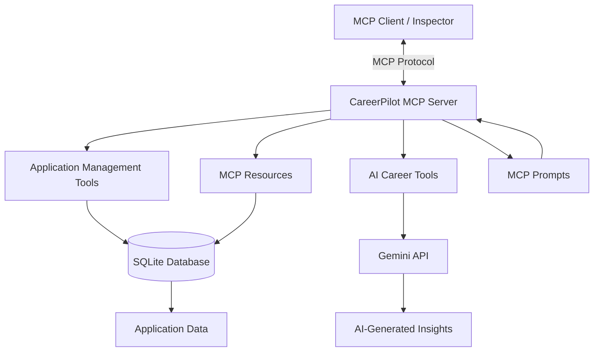

# CareerPilot MCP

An AI-powered career management assistant built using the **Model Context Protocol (MCP)**, Python, SQLite, and Google's Gemini API.

CareerPilot helps users manage job applications, analyze job descriptions, prepare for interviews, and evaluate how their skills align with job opportunities.

## Features

### Job Application Management

- Add and track job applications.
- Search applications by company or role.
- Update application statuses.
- View application statistics.

### AI-Powered Career Assistance

- Analyze job descriptions and extract key requirements.
- Generate role-specific interview questions.
- Match candidate skills against job descriptions.

### MCP Capabilities

- 8 MCP tools for career management and AI assistance.
- 2 MCP resources for application data and statistics.
- 2 MCP prompts for interview preparation and job-description analysis.

## Tech Stack

- Python 3.12
- MCP Python SDK 2.x
- SQLite
- Google Gemini API (Interactions API)
- pytest


## Architecture




## Project Structure

```text
careerpilot-mcp/
├── ai/
├── prompts/
├── resources/
├── tests/
├── .env.example
├── .gitignore
├── database.py
├── server.py
├── requirements.txt
└── README.md
```

## Setup

### 1. Clone the repository

```bash
git clone https://github.com/imsarangg/Careerpilot-MCP.git
cd careerpilot-mcp
```

### 2. Create a virtual environment

```bash
python3.12 -m venv .venv
source .venv/bin/activate
```

### 3. Install dependencies

```bash
pip install -r requirements.txt
```

### 4. Configure environment variables

Create a `.env` file using `.env.example` as a template.

Add your Gemini API key:

```env
GEMINI_API_KEY=your_gemini_api_key
GEMINI_MODEL=gemini-3.8-flash
```

Never commit your `.env` file or API key.

### 5. Run the MCP server with Inspector

```bash
uv run --active mcp dev server.py
```

This launches MCP Inspector so you can interactively test the server's tools, resources, and prompts.

## Run Tests

```bash
python -m pytest tests/ -v
```

## Current Project Status

- [x] SQLite application management
- [x] MCP tools, resources, and prompts
- [x] Gemini API integration
- [x] Input validation
- [x] Automated database and mocked AI tests
- [x] MCP Inspector integration testing

## Future Improvements

- Resume parsing and candidate profile management.
- Job recommendations based on candidate skills.
- Additional MCP client integrations.
- Secure remote MCP deployment and authentication.

## Author

Developed as a portfolio project exploring Python, AI integration, database management, and MCP-based applications.
